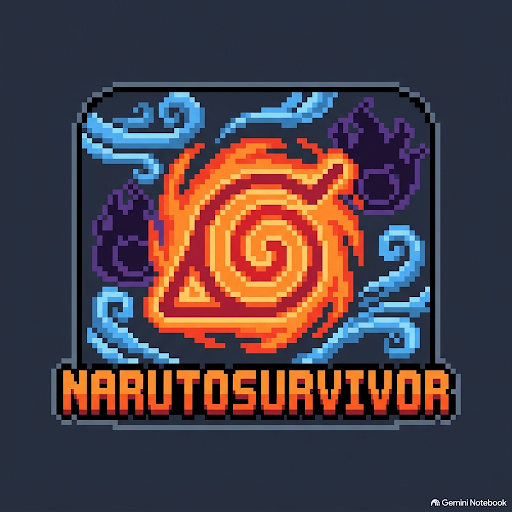

<p align="center">
  
</p>

<h1 align="center">NarutoSurvivor — Shinobi Chronicles</h1>

<p align="center">
  <b>Un browser game roguelite / horde-survival non-profit ambientato nell'universo di Naruto</b><br />
  Ispirato al genere di <i>Vampire Survivors</i> e all'interfaccia di <i>PokéSurvivor</i>.
</p>

<p align="center">
  
  
  
  
</p>

---

## 📖 Indice
- [Descrizione del Progetto](#-descrizione-del-progetto)
- [Caratteristiche Principali](#-caratteristiche-principali)
- [Roster Shinobi (106 Personaggi)](#-roster-shinobi-106-personaggi)
- [Sistema di Ricerca e Filtri](#-sistema-di-ricerca-e-filtri)
- [Sistema Gacha ed Economia](#-sistema-gacha-ed-economia)
- [Comandi di Gioco](#-comandi-di-gioco)
- [Stack Tecnologico](#-stack-tecnologico)
- [Installazione e Avvio Rapido](#-installazione-e-avvio-rapido)
- [Struttura del Progetto](#-struttura-del-progetto)
- [Disclaimer Legale](#-disclaimer-legale)

---

## 🍃 Descrizione del Progetto

**NarutoSurvivor** è un survival roguelite 2D top-down in cui il giocatore impersona uno shinobi dell'universo di *Naruto* (dalle origini classiche fino alla Quarta Guerra Mondiale Ninja) e deve sopravvivere a ondate crescenti di nemici, ninja rinnegati, marionette e boss leggendari.

Raccogliendo globi di Chakra rilasciati dai nemici sconfitti, il ninja sale di livello, apprende nuove tecniche e jutsu ad attivazione automatica e scatena devastanti **Tecniche Combinate ed Effetti Elementali**.

---

## ⚡ Caratteristiche Principali

- **Schermata Home in stile PokéSurvivor**:
  - Top bar completa con saldo **Ryo** (`🪙`), **Rotoli di Evocazione** (`📜`), **Sigilli Ninja** (`🔖`) e pill del profilo giocatore (`👑 ShisuiUchiha`).
  - Pulsantiera superiore con toggle audio, salvataggio locale rapido e fullscreen (`⛶`).
  - Card centrale dinamica con il ninja attualmente equipaggiato, statistiche base, pill dell'elemento primario e quote del personaggio.
  - Vetrina laterale a 10 voci interattive (*Play*, *Shinobi*, *Upgrades*, *Emporio Ninja*, *Borsa*, *Gacha*, *Missioni*, *Squadra*, *Classifica*, *Impostazioni*).
  - Particellare di sfondo con foglie della Foglia in caduta libera.

- **Gameplay Horde Survival 2D ad alte prestazioni**:
  - Rendering accelerato via **PixiJS v8 (WebGL/WebGPU)** a 60 FPS stabili anche con centinaia di nemici simultanei.
  - Generazione progressiva di nemici (Zetsu Bianchi, Ninja della Pioggia, Marionette di Suna, Ninja d'Elite).
  - Scontri periodici con Boss canonici (Orochimaru, Madara, Kaguya) che rilasciano ricompense speciali e Rotoli di Evocazione.

- **Albero dei Talenti Permanenti (Upgrades)**:
  - Potenziamenti acquistabili nel tempio con i Ryo guadagnati durante le sessioni: *Punti Vita (HP)*, *Danno Jutsu*, *Velocità di Movimento* e *Moltiplicatore Ryo*.

- **Sistema di Salvataggio Persistente (`SaveSystem`)**:
  - Profilo salvato automaticamente nel `localStorage` del browser, con tracciamento di shinobi sbloccati, frammenti posseduti, statistiche storiche (partite totali, miglior tempo, livello massimo raggiunto e nemici sconfitti).

- **Audio Engine Dinamico (`AudioManager`)**:
  - Effetti sonori procedurali sintetizzati in tempo reale con le **Web Audio API** (nessun file audio esterno pesante da scaricare).

---

## 🥷 Roster Shinobi (106 Personaggi)

Il gioco include **106 shinobi canonici** suddivisi in 5 gradi di rarità:

| Grado | Categoria | Numero | Esempi di Shinobi Notabili |
| :---: | :--- | :---: | :--- |
| **1★** | **Genin / Accademia** | **23** | **Naruto (bambino)\***, **Sasuke (bambino)\***, **Sakura (bambina)\***, Rock Lee, Shikamaru, Neji, Hinata, Gaara Genin, Haku, Teuchi (Maestro Ichiraku Ramen), Dosu, Zaku, Kin |
| **2★** | **Chūnin / Specialisti** | **22** | Gaara Chūnin, Sai, Yamato, Iruka Sensei, Suigetsu, Karin, Jūgo, Kushina Uzumaki, Genma, Baki, Quartetto del Suono (Jirōbō, Kidōmaru, Sakon/Ukon, Tayuya) |
| **3★** | **Jōnin / Akatsuki** | **27** | Kakashi Sharingan, Might Guy, Asuma, Kurenai, Itachi Akatsuki, Kisame, Sasori, Deidara, Hidan, Kakuzu, Konan, Zabuza, Shisui Uchiha, Danzo, Kabuto, Jinchūriki (Yugito, Yagura, Roshi, Utakata, Fuu) |
| **4★** | **Leggendari / Kage** | **22** | Minato Namikaze, Jiraiya, Tsunade, Orochimaru, Hashirama, Tobirama, Hiruzen, Killer Bee, Quarto Raikage, Terzo Tsuchikage Ōnoki, Pain Tendo, Naruto Saggio, Sasuke MS, Edo Kage (Mū, Gengetsu, Terzo Raikage, Rasa) |
| **5★** | **Sei Vie / Divinità** | **12** | Naruto Sei Vie, Sasuke Rinnegan, Madara Decacoda, Obito Decacoda, Guy della Notte (8 Porte), Kaguya Ōtsutsuki, Hagoromo, Hamura, Indra, Asura, Toneri, Momoshiki |

*\* All'inizio del gioco, solo il Team 7 classico (Naruto, Sasuke e Sakura bambini) è sbloccato di default. Tutti gli altri 103 personaggi si sbloccano tramite il sistema Gacha.*

---

## 🔍 Sistema di Ricerca e Filtri

All'interno della sezione **"Shinobi"** è integrata una suite completa per la ricerca rapida:

1. **Barra di Ricerca in Tempo Reale**:
   - Ricerca istantanea per nome italiano (*es. "Naruto", "Itachi", "Minato", "Gaara"*), nome giapponese (*es. "うずまき"*), nome del jutsu, saga narrativa o elemento.
   - Tasto rapido `✕` per cancellare il testo digitato.
2. **Pill Rapide di Fazione (1-Click Presets)**:
   - `🔥 Uchiha` • `🍃 Hokage` • `☁️ Akatsuki` • `🦊 Jinchūriki` • `🐍 Sannin` • `⚔️ Spadaccini` • `🎵 Suono` • `🍜 Ichiraku`
3. **Filtri di Stato Sblocco**:
   - `TUTTI (106)` • `✅ SBLOCCATI` • `🔒 DA SBLOCCARE`
4. **Filtri per Grado / Rarità**:
   - `TUTTI` • `1★ Genin` • `2★ Chūnin` • `3★ Jōnin` • `4★ Kage` • `5★ Sei Vie`
5. **Filtri per Elemento**:
   - `🔥 Katon (Fuoco)` • `🍃 Fūton (Vento)` • `⚡ Raiton (Fulmine)` • `🪨 Doton (Terra)` • `🌊 Suiton (Acqua)` • `✨ Yin-Yang / Sei Vie`
6. **Ordinamento Dinamico**:
   - Ciclo tra: *Rarità (5★ ➔ 1★)*, *Rarità (1★ ➔ 5★)*, *Nome Alfabetico (A ➔ Z)*, *Punti Vita (HP)*, *Danno Jutsu*, *Velocità*.
7. **Paginazione Ottimizzata a 10 Carte**:
   - Navigazione con bottoni `[ ◀ PRECEDENTE ]` e `[ SUCCESSIVA ▶ ]` o tramite frecce direzionali della tastiera (`◀` / `▶`).

---

## 📜 Sistema Gacha ed Economia

- **Altare di Evocazione dei Rotoli**:
  - Evocazione Singola (1x) o Multipla (10x).
  - Costo: **Rotoli di Evocazione** (ottenibili sconfiggendo i Boss) o **Ryo** di riserva.
  - Tassi di drop canonici bilanciati:
    - **5★ Sei Vie / Divini**: 2.0%
    - **4★ Leggendari / Kage**: 6.0%
    - **3★ Jōnin / Akatsuki**: 16.0%
    - **2★ Chūnin / Specialisti**: 31.0%
    - **1★ Genin**: 45.0%
- **Sistema a Frammenti di Promozione**:
  - Trovare un duplicato di un ninja già posseduto converte l'evocazione in **Frammenti di Chakra**.
  - I personaggi 1★ e 2★ possono essere promossi fino a 5★, aumentando vertiginosamente le proprie statistiche e sbloccando moltiplicatori di farming per Ryo e Chakra.

---

## 🎮 Comandi di Gioco

| Tasto | Azione |
| :--- | :--- |
| `W` `A` `S` `D` / `Frecce` | Muovi lo shinobi nell'arena di sopravvivenza |
| *Automatico* | Attacco base e rilascio Jutsu a tempo |
| `◀` / `▶` *(nella schermata Shinobi)* | Cambia pagina nel catalogo personaggi |
| `ESC` | Torna al menu principale / Chiudi finestra modale attiva |
| `M` *(durante la partita)* | Menu di pausa / Termina sessione |

---

## 🛠️ Stack Tecnologico

- **Rendering Engine**: [PixiJS v8](https://pixijs.com/)
- **Linguaggio**: [TypeScript](https://www.typescriptlang.org/) (Strict Mode attivo)
- **Bundler & Build Tool**: [Vite](https://vitejs.dev/)
- **Stile & Layout**: HTML5 Canvas, CSS Vanilla moderno con glassmorphism
- **Font**: Google Fonts (*Outfit*, *Inter*)

---

## 🚀 Installazione e Avvio Rapido

### Prerequisiti
- [Node.js](https://nodejs.org/) (versione 18 o superiore consigliata)
- `npm` (incluso con Node.js)

### 1. Clona il Repository
```bash
git clone https://github.com/SamDegTest/NarutoSurvivor.git
cd NarutoSurvivor
```

### 2. Installa le Dipendenze
```bash
npm install
```

### 3. Avvia il Dev Server Locale
```bash
npm run dev
```
Apri il browser all'indirizzo indicato (solitamente `http://localhost:5173/`).

### 4. Compilazione per la Produzione
```bash
npm run build
```
La build ottimizzata verrà generata nella cartella `dist/`. Per visualizzarla in anteprima:
```bash
npm run preview
```

---

## 📂 Struttura del Progetto

```text
NarutoSurvivor/
├── public/
│   ├── favicon.png         # Favicon ufficiale pixel art
│   ├── icon.png            # Icona alta risoluzione
│   └── logo.png            # Logo pixel art del gioco
├── src/
│   ├── config/
│   │   └── gameConfig.ts   # Parametri globali di gioco (risoluzione, spawn, timer)
│   ├── data/
│   │   ├── roster.ts       # Database dei 106 Shinobi canonici e blueprint
│   │   ├── bosses.ts       # Parametri e pattern dei Boss
│   │   ├── enemies.ts      # Tipi di nemici e stats scalabili
│   │   ├── synergies.ts    # Combinazioni e jutsu elementali
│   │   └── jutsu.ts        # Database jutsu e proiettili
│   ├── scenes/
│   │   └── GameScene.ts    # Loop di gameplay principale (survival, spawn, hitboxes)
│   ├── systems/
│   │   ├── saveSystem.ts   # Salvataggio su localStorage e profilo giocatore
│   │   ├── gachaSystem.ts  # Tassi di drop, estrazioni 1x/10x e frammenti
│   │   ├── promotionSystem.ts # Meccanica di promozione rango a stelle
│   │   └── audioManager.ts # Sintesi audio procedurale (Web Audio API)
│   ├── types/
│   │   ├── character.ts    # Interfacce TypeScript per Shinobi, Jutsu, Statistiche
│   │   └── game.ts         # Tipi per nemici, drop e partite
│   ├── ui/
│   │   ├── MainMenu.ts        # Schermata principale PokéSurvivor
│   │   ├── CharacterSelect.ts # Schermata Shinobi con ricerca e filtri
│   │   ├── GachaModal.ts      # Altare di evocazione dei rotoli
│   │   ├── UpgradesModal.ts   # Albero dei talenti permanenti
│   │   ├── SettingsModal.ts   # Pannello impostazioni e controlli
│   │   ├── GenericInfoModal.ts# Finestre informative (Emporio, Borsa, Squadra...)
│   │   └── HUD.ts             # Interfaccia in-game (barra HP, timer, kill counter)
│   └── main.ts             # Bootstrap dell'applicazione PixiJS
├── index.html              # Entry point HTML con meta tag e favicon
├── package.json            # Dipendenze e script npm
├── tsconfig.json           # Configurazione TypeScript
└── vite.config.ts          # Configurazione Vite
```

---

## ⚖️ Disclaimer Legale

**NarutoSurvivor** è un progetto amatoriale **non a scopo di lucro** (*non-profit fan game*), sviluppato a puro fine dimostrativo e di intrattenimento per la community. 

Tutti i diritti, nomi, personaggi, tecniche e immagini del franchise **Naruto** appartengono a **Masashi Kishimoto**, **Shueisha**, **Studio Pierrot**, **TV Tokyo** e ai rispettivi titolari di copyright. Questo software non è affiliato, autorizzato o supportato in alcun modo da tali entità.
